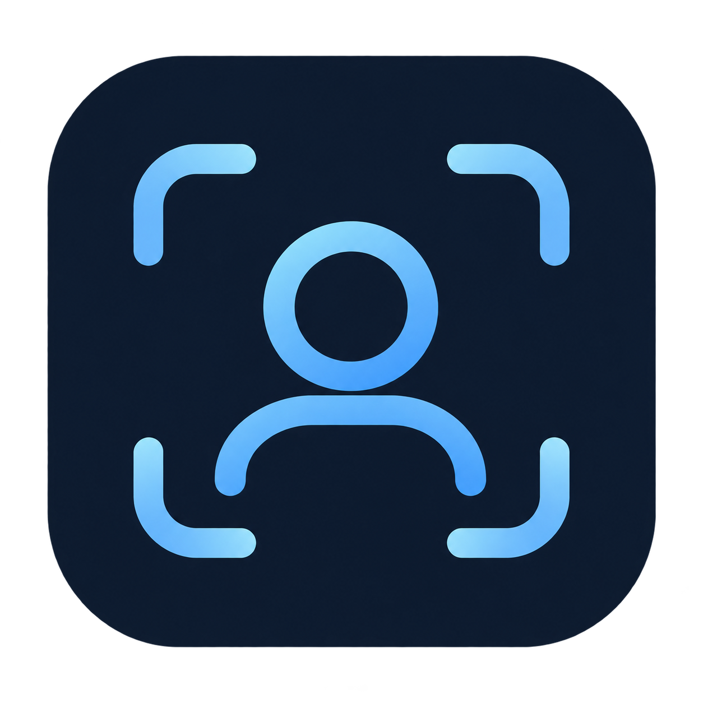
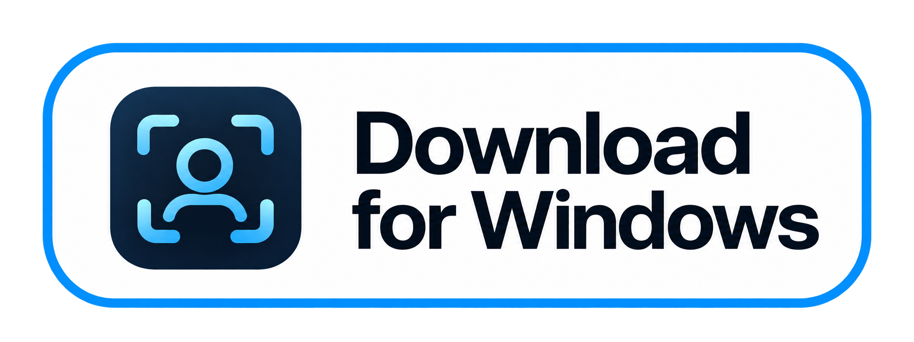
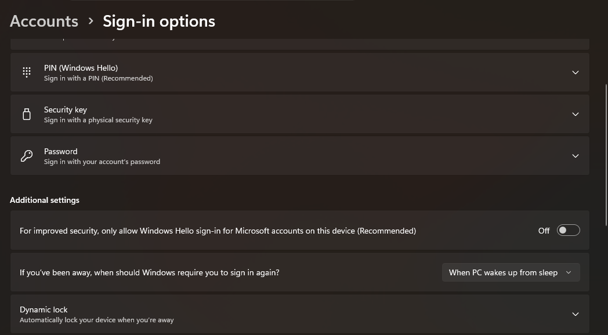

<h1 align="center">
  <br>
  <a href="https://github.com/Sampath0411/glance-windows"></a>
  <br>
  Glance
  <br>
</h1>

<h3 align="center">Face unlock for your Windows PC</h3>

<p align="center">
  <a href="LICENSE"></a>
  
  
</p>

Glance brings the FaceID-like experience of your phone to a Windows PC near you. Unlock
Windows with a glance — no typing, no reaching for the fingerprint reader. Everything runs
on-device using ONNX Runtime and InsightFace, so your face data and Windows password never
touch the internet. The app lives in a native Windows window with a dark navy interface, and
the lock screen stays Windows' own.

---

> [!WARNING]
> ## Read before installing
> ## Glance is not as secure as Windows Hello
>
> Most Windows PCs don't have the infrared or depth sensors that make Windows Hello
> trustworthy and secure. A normal webcam sees a flat 2D image. That means:
>
> - Glance checks for photos and screens and requires a blink, but these RGB-camera
>   heuristics can still accept spoofs. They are not hardware-backed liveness verification.
> - Glance does not reliably defeat a video of you.
> - Windows has no public API that lets a third-party app authorize a normal sign-in, so
>   Glance installs a Credential Provider. After a face check, that provider submits your
>   stored Windows password to the sign-in screen.
> - The stored password is encrypted with machine-scoped DPAPI. That protects it at rest,
>   but any process running on the PC can decrypt it while you are signed in.
>
> Glance is a convenience feature, not a security upgrade. Keep your Windows PIN and
> password available, and only install it on a PC you control.

## Installation

<p align="center">
  <a href="https://github.com/Sampath0411/glance-windows/releases"></a>
</p>

**Requirements:**

- Windows 11 x64
- A webcam
- Administrator approval for installation and for enabling the credential provider

Run `GlanceSetup.exe` and follow the installer. Glance installs its protected components
under `%ProgramFiles%\Glance`; the app and face agent themselves run unelevated. The
installer is currently unsigned, so Windows may show an unverified-publisher or SmartScreen
warning.

After installation:

1. Open **Glance** from Start.
2. Let Glance download the face models (~16 MB) when it asks. They come from
   InsightFace's official release, are checksum-verified, and are stored in
   `%LOCALAPPDATA%\Glance\models` — the installer does not redistribute them.
3. Verify and save your Windows password.
4. Enroll your face.
5. Turn on **Face unlock** for the Windows lock screen.

The installer copies the credential provider and helper files but does **not** enable
machine-wide face unlock by itself. You enable it inside Glance, and Windows asks for
approval when Glance needs administrator access.

## Your Windows account

Password setup needs the account name and password Windows itself asks for at the lock screen. The
name must match exactly: Glance hands the pair to Windows to verify before anything is
stored, and a name that resolves to no user comes back as the same `rejected` message as a
wrong password.

You can do this without opening PowerShell. In Glance, open **About → Windows sign-in help**
and choose **Check sign-in type**. Glance shows the account type and the name it detected.
Choose **Check password** to verify the pair without saving it; the password is entered in a
masked Glance dialog. If Windows cannot identify the account type reliably, Glance says so
instead of guessing. The commands below are optional manual diagnostics.

| Sign-in type | Account field |
|---|---|
| Microsoft account | `MicrosoftAccount\you@outlook.com` |
| Local account | `COMPUTERNAME\username`, or `.\username` |
| Work or school (Entra ID) | `AzureAD\you@company.com` |

Ask Windows for the form instead of guessing:

```powershell
whoami        # COMPUTERNAME\username for a local account
whoami /upn   # the email, for a Microsoft or work account
```

A Microsoft account always takes the **email** after the backslash — never the machine name,
and never the short profile folder name. `MicrosoftAccount\LAPTOP-1234\Alex` is split as
domain `MicrosoftAccount` with user `LAPTOP-1234\Alex`, which no account on the PC has.

A Windows Hello **PIN is not the password** and cannot be used here: it never leaves the Hello
container. If the PC signs in with Hello only, the account first needs a real password.

### Microsoft accounts: allow password sign-in

In Glance's **About → Windows sign-in help**, choose **Open Sign-in options**. On
Microsoft-account PCs, under **Additional
settings**, turn **Off** “For improved security, only allow Windows Hello sign-in for Microsoft
accounts on this device (Recommended)”. When this switch is On, Windows restricts the account
to Windows Hello sign-in; Glance's Windows credential provider needs the verified account
password to complete sign-in. Turning this option Off allows the password-based provider to
work. Keep a strong account password and your usual Windows Hello PIN available as sign-in
options.



### If the password is unknown

- **Local account** — an administrator can set a new password without knowing the old one:
  `net user YOURNAME *`. Windows warns that encrypted files and saved credentials may become
  inaccessible; that is expected for an administrator reset, and nothing is enrolled in
  Glance yet. Sign out and back in once afterwards.
- **Microsoft account** — reset it at <https://account.microsoft.com/security> on a phone,
  verification via the recovery email or phone number. Then connect the PC to the internet
  and sign in once with the new password so Windows refreshes its cached copy. A passwordless
  account needs a password added on that same page before Glance can store anything.
- **Work or school account** — controlled by your organisation. This build only special-cases
  Microsoft accounts, so Entra ID sign-ins tend to come back rejected even with the correct
  password. Use Windows Hello on those PCs.

### Test the pair before opening Glance

In an elevated PowerShell:

```powershell
& "$env:ProgramFiles\Glance\provider\grant_tool.exe" check --account 'COMPUTERNAME\username'
```

Type the password at the prompt; it does not echo. `check` verifies only and stores nothing,
so a mistake here costs nothing. One line comes back:

```
verify=ok status=0x00000000 sub=0x00000000 mode=trusted
```

`verify=rejected` with `0xC000006A` is a wrong password, `0xC0000064` means the account field
names no user, and `0xC0000234` is a lockout. `mode=untrusted` means the helper could not use
its privileged LSA path, which can reject a correct Microsoft-account password.

Both the helper's flags and the account separator are strict: `--account` with two dashes, one
space after `check`, and a single backslash in the account. A flag without its dashes is
reported as a missing `--account`, not as a password problem.

## Permissions

| Permission | Why |
|---|---|
| **Camera** | To see your face. Frames are processed in memory and never written to disk. |
| **Administrator** | To install under `%ProgramFiles%`, register the credential provider, and update the protected helper. Glance asks only when needed. |
| **Windows account password** | The credential provider must submit a real password after a face grant. It is verified by Windows before storage and encrypted with DPAPI. |

## How it works

1. Launch the app and follow onboarding. Verify and save your Windows password first;
   Glance needs it before it can enroll a face.
2. Capture several samples, turning your head slightly between them. Each frame becomes a
   512-number *embedding* — a mathematical fingerprint — and the image is thrown away.
3. When Windows locks, the face agent starts the camera and looks for an enrolled face —
   any enrolled person, or one selected person.
4. If the face is recognized — and the liveness checks agree you're a real person — the agent
   writes a short-lived, HMAC-signed grant bound to your account and logon session.
5. The Glance credential provider verifies that grant and submits the stored password.
   Windows' normal password and PIN providers remain available.

Opening **Your Face** or **Password** in the app asks for a face check first, so those
settings stay behind a recognized enrolled face. The pop-up never shows camera video and
fails closed if the camera or face models are unavailable.

## Features

| Feature | Description |
|---|---|
| **Face unlock** | Runs after Windows locks. The agent does nothing while the desktop is unlocked. |
| **Multiple identities** | Enroll several people or several versions of yourself. Any enrolled face may authorize an unlock, or restrict it to one person in Recognition. |
| **In-app face check** | Opening Your Face or Password first matches an enrolled face in a centered pop-up. Three stable matches are required; there is no camera preview. This app gate does not run liveness checks, so a photograph could pass it; the Windows lock-screen provider retains liveness checks. |
| **Liveness checks** | Four spoof cues plus a required blink for Windows and in-app verification. Movement alone cannot authorize access. RGB heuristics can still miss spoofs. |
| **Native Windows** | A real Win32 window: frameless glass shell, grouped sidebar, custom caption buttons, edge resize, snap, and maximise. |
| **Glass interface** | A painted aurora backdrop under translucent panels, glass setting groups, and Windows-style window controls. |
| **Six focused screens** | General, Your Face, Password, Camera, Recognition, and About. |
| **Camera & recognition** | Choose the camera, match threshold, verification timeout, and autostart behavior. |
| **Guided enrollment** | Automatically collects and saves 18 quality-checked face samples, with gentle pose prompts and in-app capture feedback. |
| **Idle auto-lock** | Optional keyboard/mouse inactivity lock, off by default, adjustable from 1 to 120 minutes (5 minutes by default). |
| **Fail closed** | No enrolled faces, a missing credential, a stale grant, an unavailable camera or face model, or any provider error falls back to the normal Windows password tile. |
| **Your data, your call** | Edit or delete your enrollment or stored password at any time. |
| **Local by design** | Recognition and liveness run on-device. No face data, camera frames, or credentials are sent to a server. |

---

# Privacy and Security

Glance is designed to keep biometric data and credentials on the device.

### Face data

Glance never stores camera images. During enrollment, each captured face is converted into a
**512-dimensional embedding** using an ArcFace model. The original frame is then discarded.

Enrollment starts only after you enter a name and choose **Start capture**. Glance guides you
through straight-ahead, slight left/right, and slight up/down views; it accepts 18 clear,
distinct samples and saves them automatically. The colored segments show sample coverage, not
authentication confidence. Capture animation plays only in the app; it is not shown on the
Windows lock screen.

Optional **Auto-lock when idle** is in General settings. It is off by default and uses Windows
keyboard/mouse inactivity while background protection is running. After an idle-triggered
lock, a fresh key press or mouse movement is required before face verification starts.

Embeddings are stored locally in `%LOCALAPPDATA%\Glance\data\identities.json` and protected
by your Windows profile's file permissions. This build does **not** encrypt the embedding
file. A 512-number embedding is not an image and cannot be turned back into one, but it is
still biometric data: use a Windows account with a strong password, and delete the file if
you stop using Glance.

### Credentials

Your Windows password is never written to disk in plaintext. It is encrypted with **DPAPI**
at **machine scope** and stored under `HKLM\SOFTWARE\Glance`.

Limitation, stated rather than buried: machine-scoped DPAPI defends the password against a
copied registry hive, but not against a process running on this PC. A service-held secret with
a narrower ACL is future hardening work. Treat Glance as convenience software, not as a vault.

### Unlock pipeline

Glance won't submit your password simply because a face matches. An unlock requires all of
the following:

1. An enrolled face is authorized — any enrolled person, or the selected person in single-person mode.
2. The PC is actually locked.
3. A face matches above the configured similarity threshold.
4. Liveness checks accept the detected face.
5. A fresh grant is written for this account and logon session.
6. The credential provider verifies the grant before reading the stored password.

Recognition and liveness run independently and must both succeed before the grant is written.
The grant expires after a few seconds and can be used once.

### Local by design

Face recognition, enrollment, and liveness detection run entirely on-device with ONNX
Runtime. Glance does not send face data, camera frames, or credentials to a server.

### How it tells a face from a photo

Four spoof cues and a required blink are evaluated over a rolling window. They are
not averaged into a single score:

- **Deny cues** are evidence of a spoof. Any one of them fails the scan outright and overrides
  every confirm cue:
  - **Glare** — one large flat specular blob where a real face would show scattered skin
    highlights, as a glossy print or a glass-covered screen does.
  - **Screen glow** — a bright, colour-neutral, almost textureless panel immediately around
    the face, which is what a held-up phone or a monitor looks like.
  - **Device edges** — a device-shaped rectangle framing the face, including a phone whose
    screen edge only partly encloses a close-up face. A doorway or window is far larger than
    the face and does not count.
  - **Print or moiré texture** — a periodic pattern in the face crop, from a photographed
    display pixel grid or a printed halftone. The cue only fires when that pattern is actually
    visible, so smooth skin and soft lighting gradients do not trip it.
- **Blink** — a dip and recovery in estimated eye openness, measured from pixels inside
  the aligned face. Authorization waits for this cue; absence of a blink times out.
- **Micro-motion is diagnostic only.** Phone movement and detector jitter can change
  landmark ratios. Real-world testing exposed this bypass in 0.1.4, so movement no
  longer authorizes access.

**Heavy** (the default) and **Strict** now both require a blink and reject any deny cue.
In-app verification also requires a blink. Light mode is for CLI diagnostics only;
the Windows verifier promotes it to Heavy. Missing or malformed settings use Heavy. When a
matching face is seen but no proof of life arrives before the timeout, the agent records a
denial rather than "no face", so the log says what happened.

These are RGB-camera heuristics, not a guarantee against photos or screens. Alignment
errors and lighting changes can fool pixel measurements; a video replay can contain real
blinks. Synthetic tests do not establish real-world spoof resistance. Validate with real
phones and prints; use a hardware-backed authentication system for stronger assurance.

---

## Building from source

### Prerequisites

- Windows 11 x64
- Python 3.12 x64
- Visual Studio Build Tools with the **Desktop development with C++** workload
- Inno Setup 6 (only for building the installer)

### Run from source

1. Clone the repository:

   ```powershell
   git clone https://github.com/Sampath0411/glance-windows.git
   cd glance-windows
   ```

2. Create the environment and install pinned dependencies:

   ```powershell
   py -3.12 -m venv .venv
   .venv\Scripts\python.exe -m pip install -r requirements-lock.txt -r requirements-build.txt
   ```

3. Fetch the face models (optional; the app offers to download them on first launch):

   ```powershell
   .venv\Scripts\python.exe tools\fetch_models.py models\buffalo_s
   ```

4. Launch Glance:

   ```powershell
   Glance.bat
   ```

### Build the installer

```powershell
# Publishable: ships no weights; the app downloads them on first run.
powershell -ExecutionPolicy Bypass -File packaging\build_windows.ps1 -BuildInstaller -WithoutModels

# Local testing: bundles the weights into the app for offline use.
powershell -ExecutionPolicy Bypass -File packaging\build_windows.ps1 -BuildInstaller
```

Installers and unpacked builds are written to `dist\` and `build\`. A bundled build must not
be published without redistribution permission from InsightFace; `-WithoutModels` is the
release configuration.

### Run the tests

```powershell
.venv\Scripts\python.exe -m tests.test_desktop
.venv\Scripts\python.exe -m tests.test_cli
.venv\Scripts\python.exe -m tests.test_liveness
.venv\Scripts\python.exe -m tests.test_grant
.venv\Scripts\python.exe -m unittest tests.test_packaging -v
.venv\Scripts\python.exe -m unittest tests.test_backend_helper tests.test_admin_helper_policy tests.test_pending_grant tests.test_agent_paths tests.test_agent_startup_diagnostics -v
.venv\Scripts\python.exe -m unittest tests.test_fetch_models tests.test_packaged_icon tests.test_collect_notices -v
```

The interactive developer menu lives in `scripts\run.bat`.

### Project structure

```
glance/              application package
  core.py            face detection, alignment, and recognition
  liveness.py        anti-spoof cues
  paths.py           source and installed path resolution
  agent/             lock-screen verification agent
  desktop/           PySide6 desktop UI
  cli/               enrollment, evaluation, and repair commands
tests/               regression suites
scripts/             source launchers and the developer menu
tools/               model, icon, and notice build utilities
tools/diagnostics/   developer probes and diagnostics
packaging/           Nuitka build, Inno Setup script, notices
provider/            C++ credential provider and grant helper
assets/              approved app artwork
docs/                release checklist
```

## Contributing

This is a personal Windows port. Issues and focused fixes are welcome; for larger changes,
open an issue first so the security-sensitive sign-in path can be reviewed.

## Acknowledgements

- **[Glance for macOS](https://github.com/jonnyoo/glance)** by Jonathan Zhou — the original
  app, recognition pipeline, and liveness design this port follows.
- **[InsightFace](https://github.com/deepinsight/insightface)** — the ArcFace and SCRFD models
  doing recognition and detection.
- **[Qt for Python](https://doc.qt.io/qtforpython-6/)** — the native-feeling desktop UI.
- **[ONNX Runtime](https://onnxruntime.ai/)** — on-device inference.
- **[Nuitka](https://nuitka.net/)** and **[Inno Setup](https://jrsoftware.org/isinfo.php)** —
  the Windows build and installer.

## License

[MIT](LICENSE) © 2026 Glance contributors

The bundled InsightFace `buffalo_s` weights have a separate **non-commercial
research-only** restriction; the MIT license does not apply to those weights. See
[`THIRD_PARTY_NOTICES.md`](THIRD_PARTY_NOTICES.md). Do not use or redistribute the weights
commercially without separate permission.
